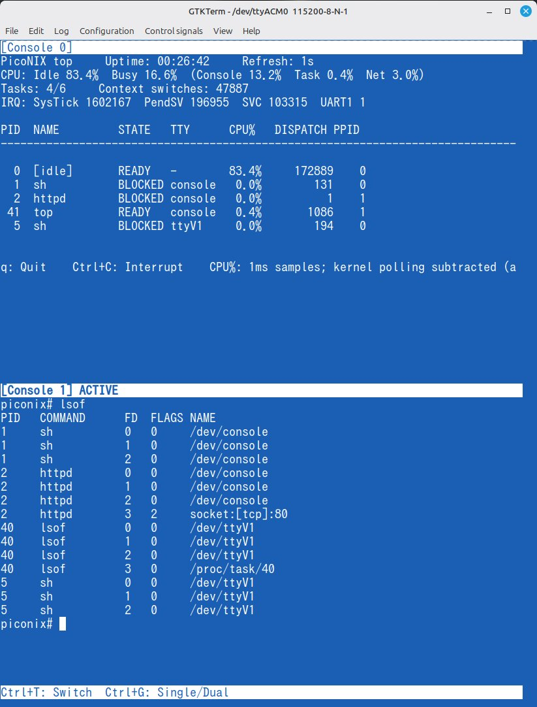

# PicoNIX

**A tiny UNIX-like OS for Raspberry Pi Pico and Pico W — with multitasking, interactive virtual consoles, and user-space networking.**

PicoNIX is an educational and experimental UNIX-like OS for RP2040 microcontrollers. It combines a shell, multitasking, a virtual file system, device files, and a compact TCP/IP socket interface for ordinary user programs. Its terminals, tracing, and monitoring tools also make it an interactive execution and evaluation environment for human learners and LLM agents.

Unlike firmware that exposes only a built-in network service, PicoNIX lets user applications create TCP and UDP clients and servers through familiar socket APIs.

**Development and authorship.** The design principles and specifications of PicoNIX are determined by its creator based on their knowledge and experience. The source code and documentation are generated and refined using ChatGPT in accordance with these decisions. The creator reviews the results and carries out build and hardware verification as development proceeds. See the [development diary](docs/en/DEVELOPMENT_DIARY.md) ([日本語](docs/ja/DEVELOPMENT_DIARY.md)) for the development process.

**開発体制について．** PicoNIXの設計方針と仕様は，作成者の知識と経験に基づいて決定しています．ソースコードとドキュメントは，これらの方針に従ってChatGPTを用いて生成・改良したものです．開発の経緯は[開発日誌](docs/ja/DEVELOPMENT_DIARY.md)をご覧ください．

## Features

- **Kernel and processes:** XIP kernel on RP2040, six fixed 24 KiB application slots (including 4 KiB reserved stack per slot), PIC user programs copied from Flash to SRAM, multitasking and an SVC-based system call interface.
- **UNIX-like environment:** shell, pipes and redirection, virtual filesystem, RAM files, `/dev` and `/proc`, file descriptors, devices, process and terminal control.
- **Programs:** file utilities, `edit`, `vi`, `fd`, `as`, a compact `cc`, a Python-like interpreter, and hardware experiments.
- **Tracing and monitoring:** `trace`, `top`, `mem`, `watch`, and `lsof` expose system calls, scheduling, CPU activity, memory, and open files for hands-on OS observation.
- **Games:** a growing collection including `reversi`, `sudoku`, `samegame`, `maze`, `pong`, `tictactoe`, and `mb`, playable directly in the terminal.
- **USB CDC virtual consoles:** two independent shells over one USB CDC connection, with single-console and vertically stacked dual-console views, keyboard switching, and screen-state preservation.
- **Multiple terminal connections:** access PicoNIX through USB CDC, UART1, or Telnet (Pico W), with a common TTY interface; a separate PTY supports interactive MCP agent sessions.
- **Hardware:** UART1, GPIO, PWM, ADC, I²C1, an 8×8 LED matrix and framebuffer interfaces. Pin availability differs between Pico and Pico W.
- **Pico W networking:** Wi-Fi AP/STA, lwIP IPv4 TCP/UDP sockets, loopback, Telnet and UDP remote device control in the kernel; `httpd`, `nc`, `mcpd`, echo servers and other network programs in user space.
- **MCP-controlled interactive terminal (Pico W):** The user-space `mcpd` server exposes an 80×24 virtual terminal to LLM clients. Through screen reads and keystrokes, an LLM can operate existing interactive programs such as `fd` and `vi`, including editing and saving files, without modifying those programs for AI. See the [MCP reference](docs/en/reference/commands/MCP.md) ([日本語](docs/ja/reference/commands/MCP.md)).

PicoNIX is an educational system rather than a POSIX-compliant or security-hardened OS. In particular, it does not provide normal UNIX user permissions or process isolation. Read the [specification](docs/en/reference/SPECIFICATION.md) ([日本語](docs/ja/reference/SPECIFICATION.md)) and [differences from Linux](docs/en/reference/DIFFERENCES.md) ([日本語](docs/ja/reference/DIFFERENCES.md)) before relying on Linux behavior.

<p align="center">
  
</p>

## Getting started

Install the Pico SDK, toolchain, and prerequisites by following the **[English setup guide](docs/en/setup/SETUP.md)** or **[日本語セットアップ手順](docs/ja/setup/SETUP.md)**. The guides cover environment preparation, firmware builds, flashing and serial/network connections.

After setup, build from the repository root:

```sh
# Raspberry Pi Pico
./tools/build_sdk.sh -DPICO_BOARD=pico -DCMAKE_BUILD_TYPE=MinSizeRel

# Raspberry Pi Pico W
./tools/build_sdk.sh -DPICO_BOARD=pico_w -DCMAKE_BUILD_TYPE=MinSizeRel
```

Once connected to the PicoNIX shell, use `help` to list commands and `help NAME` for command usage. The on-device read-only `/man` directory contains a ROM reference manual; start with `cat /man/README`. On Pico W, the user-space HTTP server serves `/etc/index.html`; use `edit /etc/index.html` to change the page (RAM changes are lost at reboot).

## Specifications and references

The following links go **directly** to the current technical specifications and reference documents. The English and Japanese editions use matching topic structures.

| Topic | English | 日本語 |
|---|---|---|
| **System specification and limitations** | [Specification](docs/en/reference/SPECIFICATION.md) | [システム仕様](docs/ja/reference/SPECIFICATION.md) |
| **Differences from Linux** | [Compatibility and differences](docs/en/reference/DIFFERENCES.md) | [Linuxとの違い](docs/ja/reference/DIFFERENCES.md) |
| **Architecture** | [Architecture](docs/en/reference/ARCHITECTURE.md) | [全体構造](docs/ja/reference/ARCHITECTURE.md) |
| **Kernel internals** | [Internals](docs/en/reference/INTERNAL.md) | [カーネル内部](docs/ja/reference/INTERNAL.md) |
| **System calls and ABI** | [System calls](docs/en/reference/SYSCALLS.md) | [システムコール](docs/ja/reference/SYSCALLS.md) |
| **C library interfaces** | [Library reference](docs/en/development/apps/c/LIBC.md) | [Cライブラリ](docs/ja/development/apps/c/LIBC.md) |
| **Memory organization** | [Memory layout](docs/en/reference/MEMORY-LAYOUT.md) | [メモリ配置](docs/ja/reference/MEMORY-LAYOUT.md) |
| **Processes, files, pipes and VFS** | [Filesystem](docs/en/reference/FILESYSTEM.md) | [ファイルシステム](docs/ja/reference/FILESYSTEM.md) |
| **Initial filesystem and boot** | [Initial files and rc](docs/en/reference/INITIAL-FILES.md) | [初期ファイルとrc](docs/ja/reference/INITIAL-FILES.md) |
| **Commands and shell usage** | [Command reference](docs/en/reference/commands/README.md) | [コマンドリファレンス](docs/ja/reference/commands/README.md) |
| **Terminals and TTY** | [TTY reference](docs/en/reference/commands/TTY.md) | [TTYリファレンス](docs/ja/reference/commands/TTY.md) |
| **CDC virtual consoles** | [CDC virtual console](docs/en/reference/devices/CDC-VCONSOLE.md) | [CDC仮想コンソール](docs/ja/reference/devices/CDC-VCONSOLE.md) |
| **Devices** | [Device reference](docs/en/reference/devices/README.md) | [デバイス仕様](docs/ja/reference/devices/README.md) |
| **Board hardware and pin assignments** | [Hardware reference](docs/en/reference/hardware/README.md) | [ハードウェア仕様](docs/ja/reference/hardware/README.md) |
| **Wi-Fi, sockets and networking** | [Network reference](docs/en/reference/network/README.md) | [ネットワーク仕様](docs/ja/reference/network/README.md) |
| **MCP server and client** | [MCP reference](docs/en/reference/commands/MCP.md) | [MCPリファレンス](docs/ja/reference/commands/MCP.md) |
| **Source symbol reference** | [Kernel symbols](docs/en/reference/KERNEL-SYMBOLS.md) | [カーネルシンボル](docs/ja/reference/KERNEL-SYMBOLS.md) |

The [English reference index](docs/en/reference/README.md) and [日本語リファレンス索引](docs/ja/reference/README.md) contain additional specialized pages, including I²C, UART, network services and hardware wiring.

## Development and implementation references

These resources assume basic UNIX/Linux knowledge and focus on **reading, building and modifying the implementation**.

| Topic | English | 日本語 |
|---|---|---|
| **Development overview** | [Development guides](docs/en/development/README.md) | [開発ガイド](docs/ja/development/README.md) |
| **Kernel source map** | [Kernel call-path reference](docs/en/development/kernel/KERNEL-READING-GUIDE.md) | [カーネルソース索引](docs/ja/development/kernel/KERNEL-READING-GUIDE.md) |
| **Kernel modifications** | [Kernel development](docs/en/development/kernel/KERNEL-DEVELOPMENT.md) | [カーネル開発](docs/ja/development/kernel/KERNEL-DEVELOPMENT.md) |
| **Application programming** | [C application development](docs/en/development/apps/c/PROGRAMMING.md) | [Cアプリ開発](docs/ja/development/apps/c/PROGRAMMING.md) |
| **System call extensions** | [System call development](docs/en/development/syscalls/SYSCALL-DEVELOPMENT.md) | [システムコールの追加](docs/ja/development/syscalls/SYSCALL-DEVELOPMENT.md) |
| **Device driver extensions** | [Driver development](docs/en/development/drivers/DRIVER-DEVELOPMENT.md) | [デバイスドライバ開発](docs/ja/development/drivers/DRIVER-DEVELOPMENT.md) |
| **Network implementation** | [Network development](docs/en/development/network/NETWORK-DEVELOPMENT.md) | [ネットワーク実装](docs/ja/development/network/NETWORK-DEVELOPMENT.md) |

To find a document by task, see [Tasks](docs/en/TASKS.md) / [目的別索引](docs/ja/TASKS.md). The [development diary](docs/en/DEVELOPMENT_DIARY.md) / [開発日誌](docs/ja/DEVELOPMENT_DIARY.md) records the project history, not the normative current specification.

## Security and scope

PicoNIX is intended for local experiments and trusted laboratory environments. Telnet, UDP remote device control and the MCP remote-command interface do not provide authentication or encryption. Do not expose these services to untrusted networks. For MCP limitations and examples, consult the dedicated MCP reference above.
